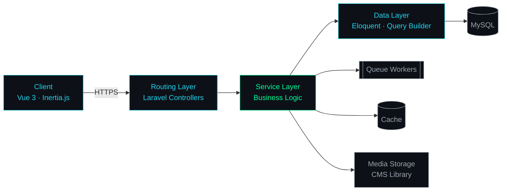

<!-- ═══════════════════════ HEADER ═══════════════════════ -->
<p align="center">
  
</p>

<p align="center">
  
</p>

<p align="center">
  
  
  
  
  
  
  
</p>

---

## `~/about`

```bash
itz-pvlse@engineering
─────────────────────────────────────────────
Name        Kassim Bakari Mwadudu
Role        Full-Stack Software Engineer
Focus       Backend Architecture · Media Systems · Database Design
Approach    Clean, maintainable, production-ready by default
Languages   PHP · Python · JavaScript · C · C++ · Java
Stack       Laravel · Vue 3 · Inertia.js · Tailwind CSS · Blade
Data        MySQL · Database Migrations · Query Optimization
Tooling     Git · Docker · Ubuntu Linux · Postman · Squircle CE
Status      ● Open for engineering opportunities & high-impact projects
```

I turn complex backend challenges into systems that are easy to reason about, easy to extend and hard to break. My work covers the full stack, from schema design and API contracts to reactive interfaces, with a strong bias toward standardization, consistency and long-term maintainability.

---

## `~/architecture`

*How I structure a typical production system:*



---

## `~/engineering-principles`

| Principle | In practice |
|:--|:--|
| **Standardize first** | Consistent conventions, naming and structure so any engineer can navigate the codebase |
| **Separation of concerns** | Thin controllers, focused services, isolated data access |
| **Design the data model early** | Normalized schemas, deliberate indexing, migrations that are safe to run |
| **Refactor continuously** | Small, safe improvements that keep technical debt near zero |
| **Ship production-ready** | Validation, error handling, logging and tests are part of the feature |

---

## `~/stack`

<table>
  <tr>
    <td width="190"><code>languages</code></td>
    <td></td>
  </tr>
  <tr>
    <td><code>frameworks</code></td>
    <td></td>
  </tr>
  <tr>
    <td><code>databases</code></td>
    <td></td>
  </tr>
  <tr>
    <td><code>devops &amp; tools</code></td>
    <td></td>
  </tr>
</table>


<!-- Place pacman-love.gif in an /assets folder in this repo -->
<p align="center">
  
</p>

<p align="center">
  
</p>


